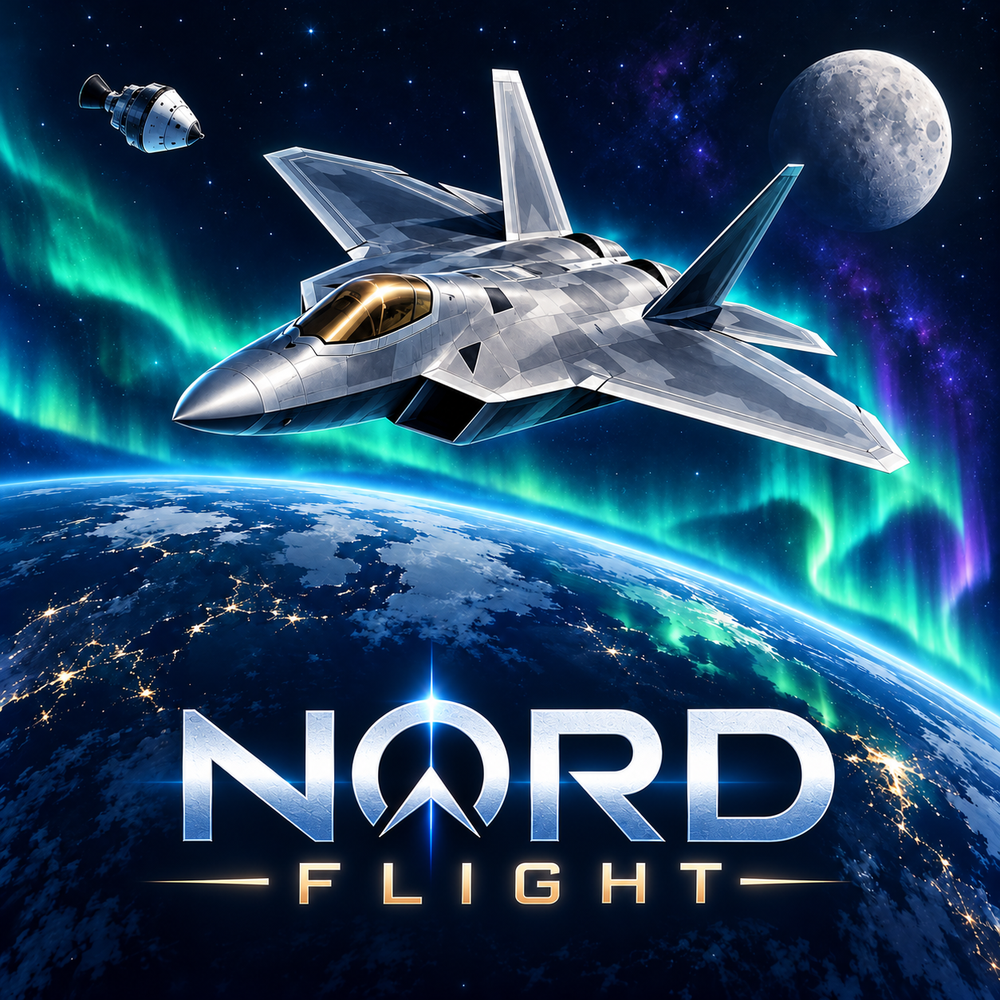
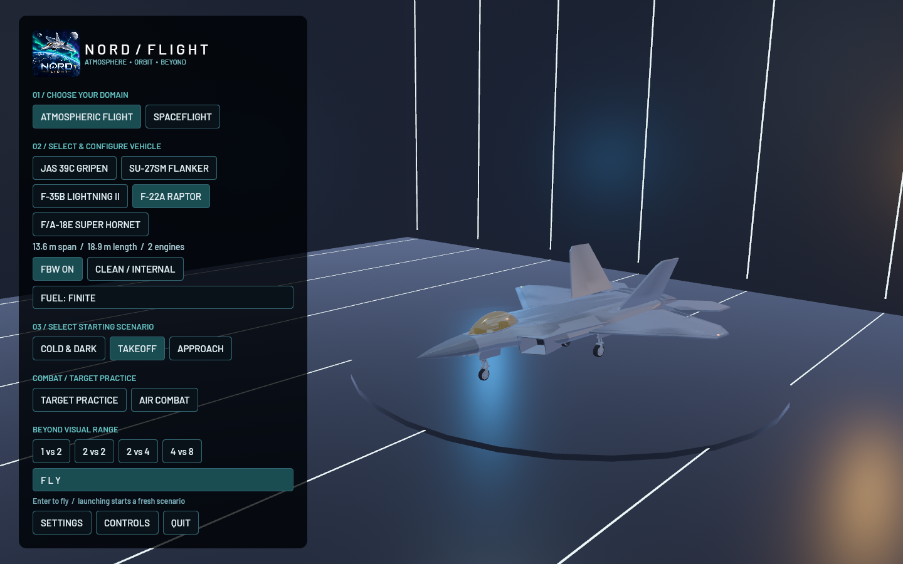

# NORD FLIGHT



Launch into the new animated **Main Menu**: choose **Atmospheric Flight** or
**Spaceflight**, select and configure your vehicle, pick a starting scenario,
then press **Fly**. **Escape** opens a pause menu with **Resume** and **Main Menu**.
The hangar and orbital previews animate independently while flight is paused.
See the [start-screen guide](docs/START_SCREEN.md).



A playable Rust / Bevy flight game with a selectable Gripen, Su-27SM, F-35B, F-22A and F/A-18F, individual aerodynamic control surfaces, and an orbital spacecraft. Open **F6 / Aircraft Hangar** to select your aircraft and reset the current atmospheric scenario. AI aircraft remain Gripens. See the [fleet guide](docs/FLEET.md) for the cockpits, STOVL, thrust vectoring, damage behavior and modeling limits. The F/A-18F exterior is adapted from a noncommercial, share-alike model; see its [attribution and license](assets/aircraft/fa18f/README.md). KSP-inspired instruments include a navball, resource gauges, SAS modes, an orbital map, and instantaneous orbital elements. The optimized Mac application is tested locally; Windows support is provided through the portable Rust project, a build script, and a two-platform CI workflow. A Windows executable has not been tested in this session.

## Start

The F-22 has received a dedicated [exterior, cockpit and flight-model refinement](docs/F22_RAPTOR.md), including controlled low-speed high-AoA flight with FBW, swept surface hinges and optional external carriage. Its aerodynamic and control-law parameters remain transparent gameplay estimates.

The [updated F-22 flight model](docs/F22_FLIGHT_MODEL_V2.md) adds tabulated engine/aerodynamic behavior, independent actuator limits, fuel-and-store inertia, signed load/pressure limits and weight-dependent approach speeds. Missiles retain their release attitude and rotate through finite aerodynamic/control moments instead of immediately steering into the airflow during separation.

The [high-altitude FBW update](docs/F22_HIGH_ALTITUDE_FBW.md) keeps fast thin-air flight in normal-load control, schedules response to available authority, and handles coupled actuator saturation during BVR maneuvers.

The F-22 alone carries the distinct [AIM-9X infrared missile](docs/AIM9X.md), with public dimensions/mass, high off-boresight acquisition, powered thrust-vector steering and improved flare rejection. Select it with **O** and launch with **Space**. Classified performance limits are represented by documented simulation estimates.

Radar weapons now use a detailed [AIM-120D-style exterior](docs/RADAR_MISSILE_VISUALS.md), with clipped solid wings, controller-driven tail fins, a ceramic radome, recessed exhaust and textured smoke. This is a visual refinement of the existing radar/BVR profiles; their flight and seeker tuning is unchanged.

Its [differential nozzle control](docs/F22_DIFFERENTIAL_TVC.md) now contributes roll torque through separate engine thrust forces, with 30% stronger stabilator loads and matching FBW allocation.

The [roll-control correction](docs/F22_ROLL_CONTROL_FIX.md) aligns nozzle, stabilator and wing-surface directions and increases low-AoA FBW roll response, with Q/E regression coverage across low speed and cruise.

**Mac:** double-click `Nord Flight.app`. The compiled app contains its font and geography assets and needs no Rust installation to play.

**Windows:** install stable Rust with the MSVC toolchain and Visual Studio C++ Build Tools, then run `build-windows.ps1`. Launch `dist/NordFlight.exe`. A normal `cargo run --release --locked` also works on either platform. A modern GPU is required; Bevy selects Metal on Mac and the appropriate Windows graphics backend.

`build-windows.ps1` also automatically creates **`dist/installer/NordFlight-Setup.exe`**.
Windows release builds open as GUI applications, without a terminal window.
Development builds retain the console for logs and diagnostics.
This single installer includes the game, runtime assets, branding icon, Desktop and
Start menu shortcuts, and an uninstaller. It installs into your local Programs
folder without administrator access; players do not need Rust or build tools.
The packaging script installs Inno Setup 6 through WinGet if it is missing.

For local updates, double-click **`Update NordFlight.cmd`** in this checkout (or
the **Update NordFlight** Desktop shortcut created by `build-windows.ps1 -Install`). It
pulls GitHub changes with `git pull --ff-only`, compiles the game, creates a new
installer and installs the update. Close the game before updating. The checkout
and build tools must remain available for this developer update command.
To update after pulling manually, run `./update-windows.ps1 -SkipPull`.
To rebuild and install without pulling, `./build-windows.ps1 -Install` also works.
To only repackage an existing build, use `./build-windows.ps1 -SkipBuild`.

## Scenarios

The buttons at the top work with the mouse. Function keys select the same scenarios (Mac keyboards may require Fn):

| Key | Scenario |
| --- | --- |
| F2 | Cold and dark on the ramp: press 1 for battery, Alt/Option + 2 for APU, then 3 for engine |
| F3 | Engine running on runway 19, ready for takeoff |
| F4 | Gripen on approach to Såtenäs F7 |
| F5 | Spacecraft in a roughly circular 220 km orbit |
| F12 | Target practice: airborne Gripen with three steady-route target aircraft |
| 4 / 5 / 8 | Air combat: Training / Balanced / Hard, with three opponents |
| 6 / 7 | Follow and cycle airborne missiles / return to previous camera |
| 2 / Alt+2 | Follow and cycle other aircraft / toggle APU (Option+2 on Mac) |
| Tab / O / Space | Next target / switch missile type / launch missile |
| V / Backspace / U | Paired flare + chaff burst / chaff only / hold to fire cannon (air combat) |
| F6 / Alt+F6 | Aircraft hangar / experimental approach assistance |

The cold-start sequence is a simplified three-switch system. Both vehicles have modeled cockpit interiors with seats, harnesses, pedals, animated stick/throttle, consoles, canopy framing, HUD glass, live flight/engine/navigation displays and a panel-mounted attitude ball. Drag to look around; Home recenters. The pilot eye is raised for forward visibility. This is a Gripen-inspired game interior, not an exact instrument or startup replica.

## Target practice

Select **F12 TARGET PRACTICE** to start airborne with three aircraft flying steady circular routes, two heat-seeking missiles and two active radar missiles. **Tab** selects the next live target, **O** switches missile type, and **Space** launches after a seeker lock. The weapon panel also has mouse buttons. It shows target range, ammunition, lock progress and hits. Target brackets work in exterior and cockpit views; orange indicates a completed lock. **R** restarts this scenario and replenishes the missiles.

Keep the nose pointed toward the selected aircraft while the seeker acquires it. All-aspect heat seekers have a shorter range; radar missiles accept a wider acquisition angle and longer range. Launches require the landing gear up. Missiles separate from the wing before ignition, then show layered white/blue/orange exhaust and a widening smoke trail. Enemy missile hits are usually lethal, with burst distance and location determining outcomes and surviving component failures. Cannon damage against enemies is strengthened too. A hit displays that enemy's component schematic for three simulation seconds before fading. Missiles can lose guidance, run out of motor impulse, miss, or strike the ground. Practice targets do not fight back; combat scenarios do.

Targets, seeker dwell and missile flight use the same configured simulation timestep as the player, including pause. Guidance uses a bounded proportional-navigation approximation based on line-of-sight rotation and closing speed ([NASA reference](https://ntrs.nasa.gov/api/citations/20170001430/downloads/20170001430.pdf)). The missiles have simplified thrust, drag, gravity, motor duration, acquisition cones and proximity fuses. Their values are tuned for gameplay. The four new aircraft include store mass, balance and drag changes with expenditure or jettison; the original Gripen retains its existing loading model.

## Air combat

Press **F1**, or click **SIMPLIFY VIEW**, to toggle a clear flight view. It hides the toolbar, large weapon/system panels, help text and external instrument panels while retaining aiming cues, essential flight data, a compact ammunition strip and incoming-missile warnings. **H** remains the help shortcut. The cockpit's physical instruments remain available; the combiner uses a less crowded pitch ladder. F1 also works while paused, and the map retains its controls.

In aircraft cockpits, click **ENEMY ICONS** or press **Option/Alt + H** to toggle floating enemy brackets and range labels across the outside view, beyond the HUD combiner. The selected enemy is amber; other enemies are red. This optional visual aid also works in simplified view and BVR, excludes allies and destroyed aircraft, and hides targets obscured by terrain. It starts disabled and remembers your choice while switching cameras.

The F-22 can sustain **Mach 1.5 without afterburner** at high altitude: use up to **88% throttle** for military power. Full afterburner is tuned for approximately **Mach 2.5 at 15 km / 49,200 ft**, gear retracted, bays closed and the standard internal loadout. This is a simulator performance target; fuel mass, altitude, external stores and damage change the available margin. The G-meter reports signed normal specific acceleration, including thrust-vectoring and landing-gear support, with approximately 1 G when parked after the suspension settles.

The selected target has a circular seeker-lock progress cue, range and closing speed (`Vc`; positive means closing). An amber edge arrow points toward a target outside the clear aiming area and identifies targets behind you. In external views, the small cannon circle shows the required aim direction; align the gun cross with it and hold **U**. In the **cockpit**, a small dim ring shows gun direction and a larger bright ring with a central dot is the computed gun director: **put the large ring on the actual target aircraft**, then hold **U**. It accounts for inherited aircraft velocity, gravity and constant target velocity; a moving range tick, range/flight-time text and a `SHOOT` cue help judge the shot. Both rings remain in simplified cockpit view. No valid solution is shown for destroyed, rearward, unreachable or out-of-range targets. Cannon rounds leave the aircraft at **4,250 m/s** (the requested fivefold gameplay increase); both sides and the aiming cues use this speed. The director cannot guarantee hits against an accelerating or evading target.

External air-combat views retain the **cannon funnel** as a second aiming reference. Its two rails represent the target's 8.4 m wingspan at virtual round ranges from 180 to 900 m, bending with aircraft turn rates and ballistic drop. Track the target with its wingspan fitting the rails. The design follows the wingspan-matching principle described in the [USAF F-16 handbook, section 4.14.3](https://www.f-16.net/downloads/F-16_Handbooks/11-f-16v5.pdf). The cockpit replaces those rails with the requested F/A-18-inspired two-ring director. Solutions extend to 2 km when an intercept exists inside the round's 2.5-second lifetime. These are game approximations, not calibrated reproductions of aircraft avionics.

The threat compass uses aircraft-relative bearing: its top is ahead and its bottom is behind. Red ticks identify approaching missiles, with **V COUNTERMEASURES** or **BKSP CHAFF** prompts. The missile readout distinguishes boost/coast, sensor signal, achieved/available turn acceleration, fuel and estimated closing time. Radar-supported missiles prompt you to keep supporting their target; lost tracks are labeled explicitly. The cockpit has matching armament/lock warnings on the HUD combiner and a weapons/target page on the right display.

The three **COMBAT** buttons, or **4 / 5 / 8**, start separate Training, Balanced and Hard scenarios. Each has three opponents that pursue, turn to engage, extend after a close pass, evade incoming missiles, and recover away from terrain. They carry heat-seeking and active-radar missiles plus a cannon. Their ammunition is finite; launches are staggered and limited by the number of live enemy missiles. Target practice remains available through F12.

**BVR SETUP** opens a dedicated screen with scenario cards for **1 vs 2, 2 vs 2, 2 vs 4, and 4 vs 8**, starting about **125 km apart** over an expanded mountain-and-valley theater. Every force size offers **Training / Balanced / Hard** and **Elimination / Intercept–Defend** independently. Choose **START MISSION** after making your selections. Setup pauses the current flight; Cancel or Escape restores its previous pause state. **M** opens the aircraft tactical map with selectable sensor-only or reveal-all views, range/elevation controls, Search/TWS/STT radar modes, aging contacts, friendly reports and missile information. The LR-AAM profile has supported midcourse guidance, lofting, autonomous terminal radar and energy-dependent launch estimates. Spacecraft retain their orbital map on M.

In the Gripen cockpit, the **right MFD** provides range/azimuth and heading-up tactical radar pages. Hold **Option / Alt** and click a track to target it, then click the **LOCK** bezel button for STT. Surrounding buttons control radar power, range, elevation, mode, next target, unlock and **PAGE**. The selected contact is amber, with bearing, closure, range, altitude, track age and launch guidance. Release the modifier to drag the camera normally. See the [BVR operations guide](docs/BVR.md) for the full controls, mission rules and model assumptions.

The **left MFD is a radar warning receiver**: green **S** search emitters, amber **L** tracking radars, and red **M** active radar missile seekers appear at their aircraft-relative bearings. Rings indicate priority rather than distance. The RWR works with your radar switched off, holds fading contacts briefly, and remains available in simplified cockpit view. Its passive RF symbols are separate from the existing missile-approach warnings.

The clean cockpit HUD and radar are available in **every Gripen scenario**, including target practice and close-range combat. Both show a **MAX / NEZ EST** launch-zone scale with a moving target-range pointer; **IN NEZ EST** marks the estimated no-escape zone. Its values follow the selected missile, not a guaranteed-hit distance. Radar scopes also show **blue friendly-missile triangles** and **red nearby closing missile threats**, with a legend. Short-range scenarios use 5 / 10 / 20 / 40 km scope settings; BVR retains 40 / 80 / 160 / 240 km.

Press **2** to follow another aircraft; repeated presses cycle through living enemies, allies and practice targets. Mouse drag orbits the aircraft and the wheel zooms. The header identifies the aircraft and shows its airspeed/altitude. **7** restores your starting camera, look direction, zoom and map state. If the watched aircraft is destroyed, another living aircraft is followed, or your camera is restored if none remain. **Alt/Option + 2** operates the APU.

Press **6** to follow an airborne missile. Press it again to cycle through live player and enemy missiles. **7** restores your previous camera, including its look direction and zoom. Switching between aircraft and missile tracking preserves the original player view. If the tracked missile ends its flight, the camera switches to another airborne missile, or returns to your previous view when none remain. **C** still cycles the four regular flight cameras. Hard combat uses **8** to leave **6** available for missile tracking.

| Profile | Control response τ | Initial launch grace | Missile launch interval | Concurrent enemy missiles | Missiles per opponent |
| --- | ---: | ---: | ---: | ---: | ---: |
| Training | 0.34 s | 14 s | 18 s | 1 | 3 heat + 3 radar |
| Balanced | 0.20 s | 6 s | 11 s | 2 | 3 heat + 3 radar |
| Hard | 0.09 s | 4 s | 6.5 s | 4 | 3 heat + 3 radar |

Difficulty changes pilot observation/control accuracy, tactics, firing discipline, cannon spread and countermeasure timing. Aircraft performance and weapon power are identical across difficulties. The grace period is staggered by another three seconds for each subsequent opponent, and a valid acquisition is still required before launch.

Every enemy, ally and practice target now uses the **same six-degree-of-freedom flight physics as you**: engine spool, thrust, fuel/mass, lift/drag, moving control surfaces, stalls, FBW limits, damage and ground contact. Pilots command controls instead of assigning speed or attitude. They manage energy, lead/lag pursuit, vertical maneuvers, overshoots, radar/missile support, defensive cranking/notching/dragging, wingman assignments and collision avoidance. All receive the same physics frequency, with strong stall/terrain recovery assistance. The normal UI stays clean; `--study-ai` writes detailed flight and combat telemetry. See the [AI flight-model and pilot guide](docs/AI.md).

**Tab / O / Space** select a target, switch missile type and launch after lock. Hold **U** to fire your cannon; align the gun cross with the lead circle. Each **V** press dispenses one flare and one chaff charge, respecting each dispenser's cooldown and inventory; an available dispenser still fires when the other is empty or cooling. **Backspace** remains chaff-only, and separate mouse buttons are available. You start with 300 cannon rounds and 24 charges of each countermeasure. Flares can divert heat seekers; chaff can divert active radar seekers. Timing, signal strength and seeker geometry affect diversion, so dispensing does not guarantee a miss. The defense panel shows radar locks, approaching missiles, bearing from your nose, range, recommended countermeasure and ammunition.

Missile hits roll minimal, critical or catastrophic damage using the same rules for both sides. At mid-distance the odds are **25% / 50% / 25%**; direct contact raises destruction probability to 70%, while an outer-edge burst lowers it to 5%. Impact location chooses the affected system. Minimal damage may cause a fuel leak; critical damage can destroy the engine, disable a system, severely damage a wing, or jam/detach a control surface. A jam freezes the panel's angle and preserves its aerodynamic loads; detachment removes those loads and creates a fragment. Existing damage accumulates, and cannon hits remain cumulative.

The compact top-left schematic always shows **your aircraft**, including in cockpit and simplified views: cyan healthy, amber degraded, magenta jammed, red failed/detached. A flame marks fire and the fault list names the most important failures. The diagram is hidden in the map. Engine and control failures affect flight and weapon support; wing damage loses lift and creates a roll imbalance. Fire is mainly visual, with a rare delayed fuel explosion after a five-second grace period. Breakup uses explosions, flame/smoke and falling fragments. Aircraft contact at **25 m/s relative speed or above** destroys both participants; slower contact damages nearby parts and separates them. Enemy–enemy collisions are included. **R** restarts and restores systems/ammunition. `--study-air-combat` writes integrated engagements to `tests/air-combat-study.json`. [The damage-model guide](docs/DAMAGE.md) documents the model and its gameplay assumptions.

## Missile dynamics and seekers

Missiles now share a sensor/navigation/guidance/controller model on both sides. All-aspect infrared seekers respond to viewing aspect, afterburner heat and sun glare. Radar weapons need aircraft updates until autonomous terminal activation, and can lose tracks in a look-down Doppler notch. Flares and chaff have geometry, aging and imperfect diversion; enemy pilots also use finite countermeasures. Rate-limited fin control and dynamic-pressure limits govern turns, which consume energy through induced drag. The missile telemetry panel shows seeker mode, speed, achieved/available g and remaining propellant. [The missile guide](docs/MISSILES.md) documents the model, parameters and limits; `--study-missiles` generates repeatable engagement diagnostics.

IR missiles resist flare-only defenses more strongly: a temporarily distracted seeker can return to an aircraft flying along the same track as the flare, or regain it as the flare cools. Dispense with **V** and make a break turn to separate from the flare; continuing straight is not a reliable defense. Afterburner makes the aircraft more attractive to the seeker. Incoming-IR warnings remain active while the missile is still closing, even if it briefly tracks a flare. The same seeker rules apply to player and enemy IR missiles; radar/chaff behavior is unchanged.

## Attitude and engine visuals

The Gripen cockpit has 40 labelled physical controls. Hold **Option/Alt + click**
to operate power and engine switches beside the left MFD, gear/flaps/airbrake/FBW
beside the center MFD, the radar bezel, and the lower target/weapon/countermeasure/
simplified-view/autopilot/help row. Active switches glow cyan; hovering identifies
the action. Mouse dragging and wheel zoom remain available for looking around.
Sixteen additional buttons and moving toggle levers sit on the left and right
side consoles beside the pilot's legs. Look down and to either side to use them;
the left console handles power/flight systems and the right handles radar,
weapons, countermeasures and view controls.

Exterior lighting has brighter coloured lenses, soft coronas, local light spill,
double-flash strobes, anti-collision beacons and stronger landing beams. Wingtip
lenses sit above their rails. Fixed-wing panel lines, root walkways and batched
fasteners add close-up surface detail. Damage adds component-linked scorch and
fragment-pit marks, sparks, darker smoke and folded metal debris. These marks
are cosmetic surface detail; persistent component failures still drive physics.

The bottom-center KSP-inspired navball shows a blue sky hemisphere, brown ground hemisphere, heading meridians, and pitch parallels every 15 degrees. The gold symbol stays fixed to the vehicle; the yellow-green circle marks prograde and the crossed circle marks retrograde when that direction lies on the visible hemisphere. Direction markers are suppressed below 0.5 m/s. The plane uses surface velocity; the spacecraft uses orbital velocity. Heading, pitch, and bank appear below the ball.

The jet engine has segmented variable nozzle petals, a recessed throat, support rings, and a throttle-driven combustion glow. Its petals and lip expand with spool while their mounts stay attached. Layered translucent meshes form the core, blue envelope and orange afterburner; daylight boosts keep it visible against a bright sky. The lunar spacecraft instead has fixed rocket bells for its transfer, descent and return engines, with layered plumes that fade downstream and lengthen in vacuum. Jet exhaust remains visible throughout powered flight. Plumes stop when thrust stops. These procedural effects are inspired by Waterfall's layered approach and contain no KSP or Waterfall assets.

The jet's full afterburner is tuned for approximately **Mach 2 in level flight at 60,000 ft (18,288 m)** with gear/flaps stowed, still air and 1,500 kg of fuel. Nominal static wet thrust is 110.4 kN, with density lapse, ram correction and a smooth high-Mach intake-loss term. The transonic drag peak is reduced so full afterburner can accelerate through Mach 0.9. Top speed comes from the thrust/drag balance; there is no velocity clamp. This is a gameplay performance target, and loading, maneuvers, altitude and wind affect the achieved speed. `--study-performance` writes the steady trim balance and controlled flight checks to `tests/jet-performance.json`.

The Gripen has a tapered fuselage and radome, refined canopy and intakes, thick delta wings, and separate hinged canards, four elevon panels, rudder, and two airbrake panels. Rendering and aerodynamics use the same deflection mapping. Each panel evaluates incremental lift/side force and drag using local airflow (including angular velocity), air density, surface area, and hinge deflection; its force produces a moment through its lever arm. Neutral-airframe aerodynamics remain in the whole-aircraft model. Flap and airbrake loads are evaluated in the moving-panel model, avoiding duplicate forces. Fly-by-wire uses the surface model's moment derivatives and flap trim. Geometry and coefficients are tunable game approximations, not validated Saab aircraft data.

The updated model includes local panel stall, Mach-dependent control effectiveness, rate-limited loaded actuators, transient vortex and sideslip states, total-lift induced drag, and coupled three-axis control allocation. [The aerodynamic guide](docs/AERODYNAMICS.md) explains the equations, signs, assumptions, tests, and current limits.

The spacecraft is now a real-scale Earth–Moon direct-return mission: a reentry capsule, ascent/return service stage, four-engine lander and transfer booster. The mission panel offers Earth orbit, lunar orbit and landing-approach scenarios, stage delta-v/reserves, heating, radar altitude and landing guidance. **Space** stages with throttle cut; **G** operates the legs; **K** arms capsule parachutes. **F7 / MODE** includes maneuver SAS. The **M** map supports Earth/Moon focus, body-relative orbits, draggable maneuver nodes, a manual lunar-transfer planning aid, and predicted SOI encounters. The descent stage remains on the Moon after liftoff. See [Earth–Moon spaceflight](docs/SPACEFLIGHT.md) for the mission, budgets, controls and modeling limits.

## Fly and land

The landscape now has adaptive terrain resolution, textured fields and grass,
rocky high ground, and batched forests with collision volumes. You can land the
Gripen on suitable open terrain: the old 48 m/s off-runway destruction rule is
removed, and the wheels react to local slopes. Grass braking is weaker than
runway braking. A broad landing meadow is at x=6,500 m, z=3,200 m, elevation 62 m.
See [the landscape guide](docs/LANDSCAPE.md) for location and limitations.

| Control | Action |
| --- | --- |
| W / Up arrow | Pitch nose down |
| S / Down arrow | Pitch nose up |
| Q / E, Left / Right arrows | Roll |
| A / D | Yaw / nose-wheel steering |
| Z / X | Advance / reduce throttle |
| Shift / Ctrl | Full throttle / zero throttle (also while paused) |
| G | Sequenced doors and gear (3.8 seconds total) |
| F11 | Show shaped collision skin |
| F | Cycle flaps |
| Y | Airbrake |
| B, hold | Wheel brakes |
| I | Toggle aircraft lights (requires battery power; landing beams follow deployed gear) |
| T | Toggle fly-by-wire rate stabilization |
| N | Toggle finite / infinite fuel for either vehicle |
| P or Escape | Pause / resume |
| R | Reset vehicle |
| V | Toggle the 3D approach-guide gates |
| H or F1 | Toggle help |
| C | Cycle locked, radial-up, fly-past, cockpit |
| Home | Recenter cockpit/external look |
| Comma / period / slash | Decrease speed (including slow motion below 1×) / increase speed / return to 1× |
| Left or right mouse, hold and move | Rotate / orbit the camera (left drags starting on scenario buttons stay with the UI) |
| Mouse wheel | Zoom |
| J | Select locked camera |
| F8 | Deliberate hangar-impact test scenario |
| F9 | Toggle faster / higher-quality graphics |
| F7, spacecraft | Cycle SAS target; enables SAS |
| L | Step daylight |
| [ / ], hold | Rewind / advance daylight |
| M | Open / close aircraft tactical map or spacecraft orbit map |
| K | Toggle wind in the Gripen / arm capsule parachutes in spacecraft |
| Space, spacecraft | Separate current stage after cutting throttle |

There are exactly four flight cameras. Radial-up stays level with the planet independently of vehicle roll. Fly-past places a stationary observer ahead of the flight path and tracks the passing vehicle. The spacecraft map is separate: M preserves flight camera and warp. It shows a physical-scale 3D planet, current orbit, AP/PE and ship markers. Add a maneuver node, drag NODE along the orbit, and drag P/R/N handles to edit signed prograde/radial/normal delta-v. The orange orbit predicts an instantaneous planned impulse; nodes do not execute burns.

WARP SETTINGS opens the editable rate list; click the list, type comma-separated rates, and press Enter to save locally. Delete clears the field; Escape cancels. Rates are bounded to 0.1–100,000× and stored in `~/.nord-flight/settings.json`. From 1×, comma selects 0.75×, then 0.5×, 0.25× and 0.1× with the default rates; period steps back up and slash returns to 1×. Slow motion also works near terrain and while landed. High warp is restricted to quiet spacecraft coasts; powered/attitude-controlled spacecraft are limited to 4×, aircraft to 2×, and near-ground/landed states to at most 1×. Full physics uses substeps no larger than 1/120 second; higher rates use universal-variable Kepler drift with bounded steps and SOI/entry/burn guards. Both simulation and environment clocks advance; slow motion does not change the configured timestep setting.

Original Firefly-inspired atmospheric visuals include heating-driven reentry glow and streaming plasma, and load-driven wingtip vapor. The transonic condensation cone rendering is temporarily commented out for both player and AI aircraft pending a visual revision. They depend on density, air-relative speed, Mach and load factor, and disappear in vacuum. These are visual proxies rather than fluid/thermal simulation; the cone is condensation, not a permanently visible sonic boom. No Firefly assets or code are included.

For a landing, aim down the runway centerline, keep gear down, use flaps, control speed and descent, flare gently, reduce throttle, and brake after touchdown. Hard landings, excessive bank, gear-up contact, fast off-runway impacts, excessive G load, and overspeed can damage or lose the aircraft. Touchdowns receive a score and show sink rate.

## Physical model and fidelity

The simulation stores position, velocity and orientation in double precision. Each rendered frame advances one configured simulation timestep (default 1/60 second), scaled by allowed warp. It never accumulates wall-clock debt or skips physics to catch up: at 30 rendered frames/s and the default timestep, 1× flight runs at half real-time speed. WARP SETTINGS edits and saves the timestep from 0.001 to 0.05 seconds. Full physics internally subdivides that interval into steps no larger than 1/120 second. Quiet spacecraft coasts allow up to 100,000× using bounded universal-variable Kepler drift; planned burns, SOI transitions and atmosphere/terrain approach stop high warp. Rendering subtracts a local origin in double precision before conversion to GPU floats, including near the Moon.

Implemented effects include:

- Nonlinear angle-of-attack lift, stall reduction, induced and parasitic drag, sideslip forces and ground effect.
- Aerodynamic pitch/yaw/roll moments, rate derivatives, control authority, control-surface servo response, rigid-body gyroscopic coupling, and optional fly-by-wire rate stabilization.
- Mach number, an approximate transonic wave-drag rise and thrust ram correction.
- Engine spool lag, dry / afterburner thrust, density-dependent thrust, fuel consumption and changing vehicle mass.
- Inverse-square spherical gravity, rotating-frame Coriolis and centrifugal acceleration, and differential solar gravity.
- Keplerian Earth–Sun orbital motion (eccentricity 0.0167), natural daily lighting drift, and accelerated orbital / daylight inspection controls.
- Tropospheric lapse-rate and isothermal upper-atmosphere pressure/density model, sound speed, wind shear and deterministic gusts.
- Compliant ground contact, approximate tire grip, rolling / braking friction, hard contact limits, touchdown failures and structural-load damage.
- Staged spacecraft propulsion, independent finite main/RCS supplies, delta-v accounting, capsule lift/drag/stability and heating, parachutes, patched Earth/Moon gravity, lunar terrain and spring landing legs.

**This is a physics-based prototype, not a validated Gripen study simulator.** The aerodynamic and control derivatives, inertias, stall curve, engine lapse, gear stiffness, friction and damage thresholds are approximate, open coefficients. No proprietary flight-test tables, CFD, aeroelasticity, transonic shock solution, detailed hydraulics, complete thermosphere, WGS84 ellipsoid, exact seasonal ephemeris, full weather dynamics or surveyed terrain heights are included. The planet is a spherical Earth with an analytic elliptical heliocentric orbit, axial obliquity, and a simplified reference epoch. The simplified atmosphere is intended primarily for flight below about 20 km; orbital vacuum is treated as effectively drag-free. Aircraft flight-envelope claims are not validated by the unit tests.

## Geography and art

Såtenäs F7 / ESIB is placed at 58°25′42″ N, 12°42′40″ E, elevation 181 ft. The primary runway is represented as 2264 × 45 m, with true bearing 184.59°. Airport buildings and terrain elevations are procedural approximations. The Vänern shoreline comes from Natural Earth. The globe uses NASA Blue Marble imagery. The procedural Gripen exterior includes tapered intake ducts, curved wing sections, fitted panel seams/vents, antennas and painted Swedish markings. The upper cockpit panel carries an attitude ball with velocity markers; its HUD shows a heading tape, pitch ladder, flight-path marker and live flight/system data. Navigation, formation, anti-collision and landing lights use battery power and the I toggle.

Sources and licenses:

- [LFV official Såtenäs AIP](https://aro.lfv.se/content/eaip/AIP%20AMDT%201-2026_2026_08_07/eAIP/ES-AD%202%20ESIB%20S%C3%85TEN%C3%84S%201-en-GB.html).
- [Saab Gripen C fact sheet](https://www.saab.com/globalassets/products/aeronautics/gripen-c-series/gripen_c_factsheet.pdf): public dimensions inform the approximate model; the increased afterburner output is a gameplay tuning choice.
- [NASA Blue Marble: Next Generation](https://science.nasa.gov/earth/earth-observatory/blue-marble-next-generation/), imagery credit Reto Stöckli / NASA Earth Observatory. The July base map, higher-resolution Nordic layer and historical NASA cloud composite are included locally; [Earth asset details](assets/EARTH_SOURCE.md).
- [NASA SVS CGI Moon Kit](https://svs.gsfc.nasa.gov/4720/), December 2025 lunar color mosaic, credited to NASA's Scientific Visualization Studio and the LROC/LOLA teams. A 4K JPEG derivative is included in `assets/moon.jpg`; [asset details](assets/MOON_SOURCE.md).
- [Natural Earth vector data](https://github.com/nvkelso/natural-earth-vector), public domain; country outlines and lake polygons are included locally.
- Barlow Medium typeface from [Google Fonts](https://github.com/google/fonts/tree/main/ofl/barlow); SIL Open Font License included as `assets/FONT_LICENSE.txt`.
- [Bevy](https://bevy.org), MIT / Apache-2.0; dependency versions are pinned by Cargo.lock.

## Build, checks, and source

Application code is Rust: `src/main.rs` (controls, UI, cameras), `src/physics.rs` (simulation), `src/aerodynamics.rs` (neutral airframe), `src/control_surfaces.rs` (panel loads and allocation), `src/world.rs` (geography, vehicles and scenery), `src/navball.rs`, `src/instruments.rs`, and `src/orbit.rs`. Run:

```sh
cargo test --locked
cargo run --locked -- --verify-flight
```

The numerical checks cover atmosphere reference values, spherical position, analytic orbital period and perihelion distance, finite states, fuel cutoff and ground braking. The additional diagnostic prints the experimental approach-assist behavior and checks orbital energy drift over one simulated hour. A passing build or these tests do not establish aircraft flight fidelity.

`./build-mac.sh` updates the local application bundle with the fast incremental development profile (game optimization level 1, dependencies level 3). Use `./build-mac.sh release` for the fully optimized release with thin LTO. `build-windows.ps1` builds a Windows release executable on Windows. `.github/workflows/build.yml` is a ready-to-use Mac / Windows build workflow; it has not been dispatched from this session.

Development builds omit debug symbols to reduce disk use while retaining incremental compilation. The Mac build script checks the generated `target` cache before each build and after packaging, and clears it if it exceeds 12 GiB; the following build will take longer. This bounds accumulation between builds, not peak space needed during an individual compile. Direct `cargo` commands bypass that size check. To reclaim generated files manually, use `cargo clean` in this folder; the packaged app, source and assets remain intact.

The latest multicore, collision, damage-display and GPU-upload optimizations, benchmark commands, and the local fix for the Metal dependency's Rust future-compatibility warning are documented in [Performance and build notes](docs/PERFORMANCE.md). Measured results are kept in [Validation](docs/VALIDATION.md).

Dog crew starts with a detailed seated **Dachshund named Otto** in the **F-22**. Open **DOG CREW** on the home screen or during flight to select any of the ten breeds, customize coat/markings/suit/equipment, and preview expressions. The live portrait follows the viewed F-22, hides in missile view, and reacts to signed G loads, nearby explosions, warnings, damage, engine failure and landings. Drag its top bar to move it and its lower-right corner to resize it. Blinking continues while paused; optional comic chatter follows the normal audio controls. Other aircraft and spacecraft await their cockpit fittings. See [Dog crew design and first fitting](docs/DOG_CREW.md). The portrait now sizes its supersampled render target to the panel's displayed pixels to reduce fullscreen overhead; see [fullscreen performance measurements](docs/DOG_CREW_FULLSCREEN_PERFORMANCE.md).

Flight audio includes engines/afterburners, missiles, landing gear, touchdown, countermeasures, damage and cockpit warnings, plus an embedded public-domain A-10 cannon recording for the requested gun sound. The jet mix favors exhaust roar, with turbine whine reduced to one quarter of the preceding revision. Press **9** for separate master/engine/effect/warning volumes and **0** to mute. Settings save locally. The active camera sets sound distance, stereo direction, Doppler motion and local atmosphere, including aircraft follow (**2**) and missile follow (**6**); **7** returns to the player. Player cockpit alerts are silenced while following another aircraft or missile. External vacuum is quiet; spacecraft engine vibration is heard in the cockpit. See [Audio models and references](docs/AUDIO.md) for acoustic assumptions, recording credits, controls and sound-preview diagnostics.

Dry thrust now has a stronger volume curve, while afterburner crackle and raw hiss are softened in favor of bass. Supersonic exterior sound is confined to the trailing Mach cone. Supersonic fly-bys produce a sonic boom as the shock cone reaches the camera, with a separate longer-range mix. Other aircraft's booms can also be heard muffled inside your cockpit. Switching views and your own aircraft passing Mach 1 do not create false cockpit booms.

## Results from this session

All 75 unit and regression tests passed in `tests/door-hud-light-tests.log`, including the door/wing intersection, HUD projection, lights and wing mesh checks. The earlier release-build study completed 294 polar points, six maneuver scenarios, and 100 repeated landings. The approach diagnostic was repeated after the recessed gear/door revision and landed and stopped on the runway with 2.4 m/s touchdown sink. The one-hour spacecraft coast stayed near 220 km with about 0.0003% relative orbital-energy drift. These are numerical game-model checks, not validation against Saab flight data. New app-native render checks include `tests/visual-cockpit.png`, `tests/visual-space-cockpit.png`, `tests/visual-map.png`, `tests/visual-gear-closed.png`, `tests/visual-gear-ground.png`, `tests/visual-gear-ground-open.png`, `tests/visual-gear-50.png`, `tests/visual-reentry.png`, `tests/visual-transonic.png`, and `tests/visual-far-space.png`.

## Collision and performance update

The HUD uses m/s for speed and meters for altitude. Z increases thrust and X decreases thrust; Y operates the airbrake. J selects the aircraft-locked chase camera, which follows the aircraft orientation. Hold either mouse button to rotate the camera, including around the aircraft in locked chase; use the wheel to zoom. Left drags that start on UI buttons stay with the UI.

Aircraft collision checks use a compound convex skin around the tapered fuselage, nose, canopy, intakes, wings, canards, elevons, airbrakes, fin, rudder and nozzle. Moving panels follow their rendered hinges. Continuous separating-axis sweeps and attitude interpolation detect aircraft structure/terrain strikes. The lunar lander uses four terrain-normal spring contacts, slope/impact limits and a separate approximate body-clearance check; the capsule supports low-speed recovery. F11 shows aircraft hulls or spacecraft clearance/foot contacts. These are collision approximations rather than triangle-exact structural models. F8 provides an aircraft impact demonstration.

Gear extension animates over 2.5 seconds, including reversal mid-cycle. The same wheel geometry drives rendering and contact. Each oleo has 0.32 m travel, a spring, velocity damping and a progressive bump stop; separate wheel forces also create pitch/roll moments. Compression shortens visible struts and raises the wheels. Retracted gear cannot support the aircraft, and landing with unlocked or damaged gear can cause a ground strike. Gear drag follows actual extension. Wrecks continue moving and sliding after impact; detached fragments use bounded gravity/bounce/friction and a fuel-dependent flash and smoke.

Performance work skips unchanged scenery transforms, computes the floating-origin basis once per scene update, limits HUD redraws to 20 Hz and skips unchanged text, rejects distant lake queries cheaply, and disables local shadow rendering in planetary views.

The faster graphics mode is the default: smaller atmosphere lookup textures, two shadow cascades, a 1024-pixel shadow map, and FXAA. F9 restores higher-resolution atmosphere lookups, a 2048-pixel shadow map, and 4× MSAA. Numerical tests include swept building-impact checks and moving-wreck behavior; the approach-assist regression lands and stops successfully.

## Aerodynamics update

Q/E now roll left/right; A/D yaw left/right. Arrow-key roll and W/S pitch remain available. F10 toggles aerodynamic readouts (total lift/drag coefficients, attached-flow fraction, and parasite/induced/wave/control-surface drag breakdown).

The aircraft now uses a finite swept-wing lift slope with a delta-wing vortex-lift contribution, a smooth subsonic-to-supersonic blend, Reynolds-dependent skin-friction drag using Sutherland viscosity, induced drag based on aspect ratio and span efficiency, smooth wave drag, flap/gear/airbrake drag, and high-incidence separated-flow drag. Ground effect reduces induced drag rather than adding arbitrary lift. First-order incidence and separation states provide delayed separation and recovery with hysteresis; controls lose effectiveness as flow separates. Pitch-rate lift, aerodynamic damping, and an approximate Mach-tuck pitch moment are included. Lift and side force use an orthogonal wind-axis basis, so aerodynamic power loss comes from drag.

These are semi-empirical engineering approximations, not a calibrated Gripen database or a full dynamic-stall / shock / CFD solver. The incidence lag is a simplified unsteady model, not a full Leishman–Beddoes model. Coefficients, sweep angle, efficiency, and vortex terms remain openly tunable in `src/aerodynamics.rs`.

References: [NASA induced drag coefficient](https://www1.grc.nasa.gov/beginners-guide-to-aeronautics/induced-drag-coefficient/) for the aspect-ratio formulation; [NASA dynamic-stall comparison](https://ntrs.nasa.gov/api/citations/19870009450/downloads/19870009450.pdf) for the distinction between steady stall curves and time-dependent hysteresis. The simplified model here is not presented as an implementation or validation of that report's specific models.

The still-air approach diagnostic lands and stops on the runway. The approach pitch target was adjusted for the moving-panel flap and trim loads. An automated regression checks landing, stopping, runway position, and sink rate below 3 m/s. The expanded test suite also covers takeoff/climb, local panel stall, loaded actuator rate limits, coupled control allocation, atmosphere continuity, inverted-flight instrument readouts, orbital elements, SAS alignment, low-throttle exhaust, and nozzle attachment during vacuum plume expansion.

For reproducible app-native render captures, run `cargo run --locked -- --visual-check dry`, replacing `dry` with `full`, `surfaces`, or `spacecraft` as needed. These paused scenes save screenshots to `tests/visual-<mode>.png`; they verify rendering, while the flight diagnostic and aerodynamic tests verify numerical behavior separately.

Run `cargo run --release --locked -- --study-flight` for 294 polar points, six pitch/yaw/roll maneuver scenarios, 100 repeated landings, and physics-only CPU throughput. Results go to `tests/aerodynamic-study.json`. `python3 tests/plot_study.py` creates a scientific summary figure if Matplotlib is installed.

`--benchmark-render balanced`, `--benchmark-render quality`, and `--benchmark-render orbit-balanced` run matched paused render scenes with a five-second warmup and a 40-second wall-clock sample. They save frame-time JSON reports under `tests/`. Benchmarks use a continuous event loop; ordinary gameplay keeps background-window power saving. Frame timing depends on the host, compositor, VSync, and display. CPU-only physics throughput must not be presented as GPU/render FPS.

Mac packaging defaults to the development profile for quicker iteration; release packaging remains available explicitly. Balanced graphics use FXAA and smaller atmosphere lookup textures; higher quality uses 4× MSAA and larger atmosphere lookups. Navball geometry is cached, its texture stops updating when orientation/velocity stay fixed, and panel geometry uses a fixed array without per-evaluation heap allocation. Exhaust meshes do not cast shadows. The far-terrain LOD experiment was reverted because its small measured timing benefit did not justify shoreline artifacts.

The F/A-18F now uses dedicated six-degree-of-freedom physics, twin-engine states, mass/CG/inertia updates, distributed aerodynamics, estimated flexible modes, and force-based moving-carrier operations. See the [physics evidence and limits](docs/hornet/VALIDATION.md), [parameter register](docs/hornet/PARAMETERS.md), and [carrier controls](docs/CARRIER_OPERATIONS.md). The implementation requires user flight review and does not claim a manufacturer aerodynamic database or production Hornet FBW.
